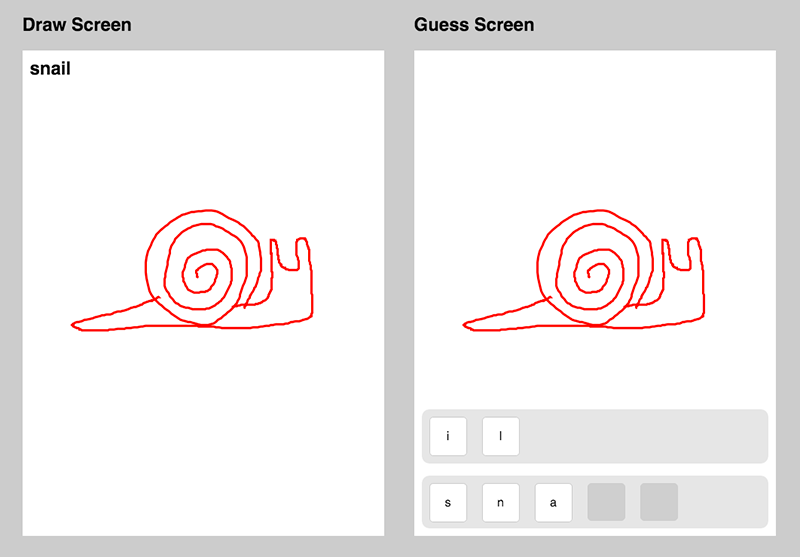

# flipDraw

Collaborative drawing game in JavaScript and Firebase.

When you load the page and select a player role, js appends a firebase id and a player role to the url. You can text the url to a friend and the page will load as the opposite player. The draw player draws the word on the screen and the drawing strokes are relayed to the guess player in svg format through firebase. The guess player can see the strokes appear and uses the letter tiles available to spell out the name of the object being drawn on both screens.



## Requirements

- [Bun](https://bun.sh) >= 1.3

## Setup

Install dependencies:

```sh
bun install
```

Create your Firebase config by copying the template and filling in your Project
settings ([Firebase console](https://console.firebase.google.com/) → Project
settings → Your apps):

```sh
cp src/firebase.config.example.js src/firebase.config.js
```

Enable the **Google** sign-in provider and the **Realtime Database** in the
Firebase console.

## Development

```sh
bun run dev
```

Compiles `src/scss` → `src/css` and starts the Bun dev server (with hot reload)
at http://localhost:3000.

## Build

```sh
bun run build
```

Writes a static production bundle to `build/` (the directory `firebase.json`
deploys to Firebase Hosting).

## Test

Unit/component tests (offline):

```sh
bun test
```

Emulator-backed tests (require the Firebase CLI and a **JDK 21+**):

```sh
bun run test:rules       # database security rules
bun run test:functions   # server-side game logic (database + functions emulators)
```

## Security model

The client may only *propose* actions; the server owns the truth.

**Security rules** ([`database.rules.json`](database.rules.json), wired into
[`firebase.json`](firebase.json)) require an authenticated user, let a player
create a game only by claiming their own role, and make the authoritative fields
(`currentAnimal`, `completed`, `winner`) **read-only to clients**.

**Cloud Functions** ([`functions/index.js`](functions/index.js)) write those
fields with the Admin SDK:

- `seedGame` — on a new game, picks the word and opens the round.
- `checkGuess` — validates a guess written to `guesses/{uid}` and, on a match,
  sets `completed`/`winner`. A client can no longer assert a win.
- `startRematch` — on a `rematch` request, swaps the roles and picks a new word.

```sh
firebase deploy --only functions,database
```

> Because the word and round flags are now server-owned, the app needs these
> functions deployed (or the Functions emulator running) to play.

**Known gap:** the guesser's client still receives the word via `currentAnimal`
(and `Letters` encodes the answer in each slot's `data-letter`), so a determined
player can still read the answer. Closing it means sending the guesser only
scrambled `letters` and keeping the answer where only the drawer can read it.

## Cloud Functions package

`functions/` is a separate Firebase Cloud Functions package:

```sh
cd functions
bun install
bun run serve    # run the local emulator
bun run deploy   # deploy to Firebase
```

## Tooling notes

- Bundling and the dev server use **Bun**'s built-in bundler and HTML entry point
  (`bun ./index.html`, `bun build ./index.html`).
- Styles are written in Sass and compiled with the `sass` CLI.
- Firebase uses the modular **v9+ API** (`firebase/app`, `firebase/auth`,
  `firebase/database`).
- `react-dragula` is unmaintained. It's only used for the letter-tile dragging in
  `src/Letters.js` and is a good candidate to replace with a maintained library.
- `src/global-shim.js` aliases Node's `global` to `globalThis`. react-dragula's
  legacy dependency chain (`dragula` → `crossvent` → `custom-event`) references
  `global`, which Bun's bundles (unlike CRA's old webpack build) don't provide.
